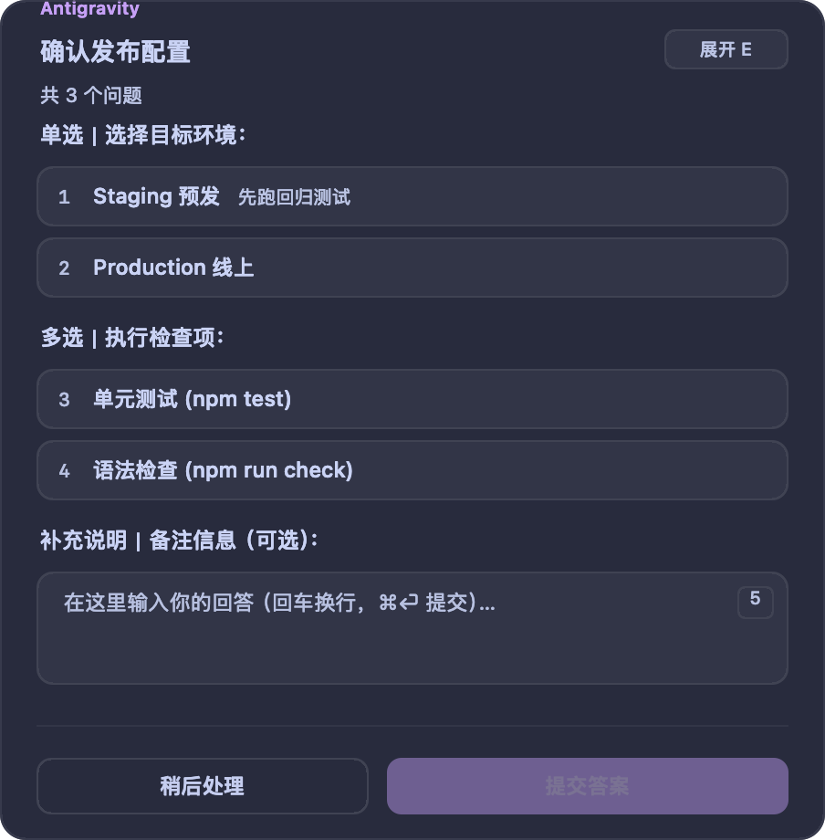
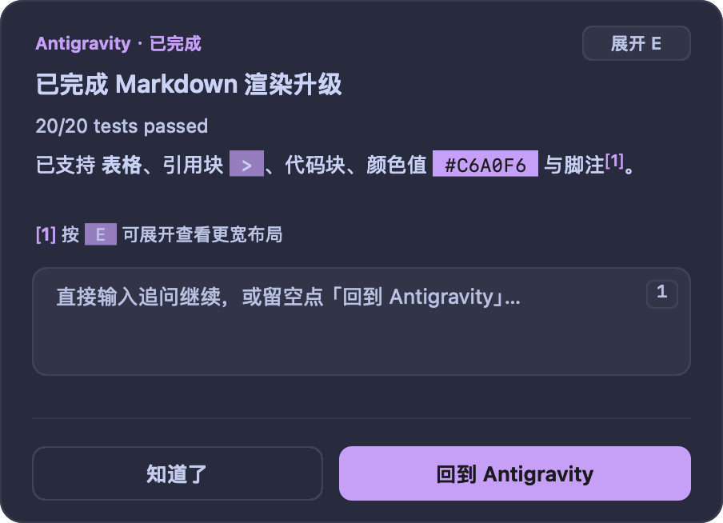
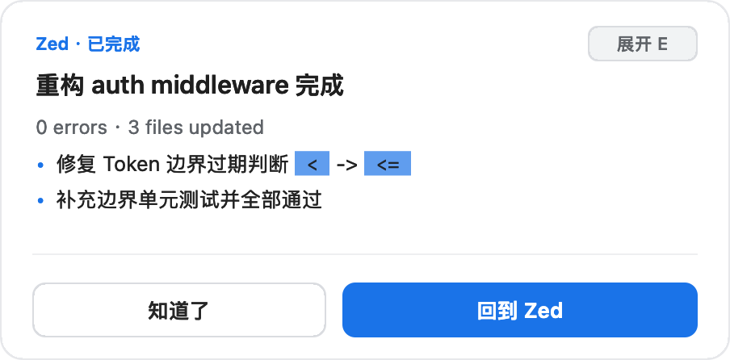
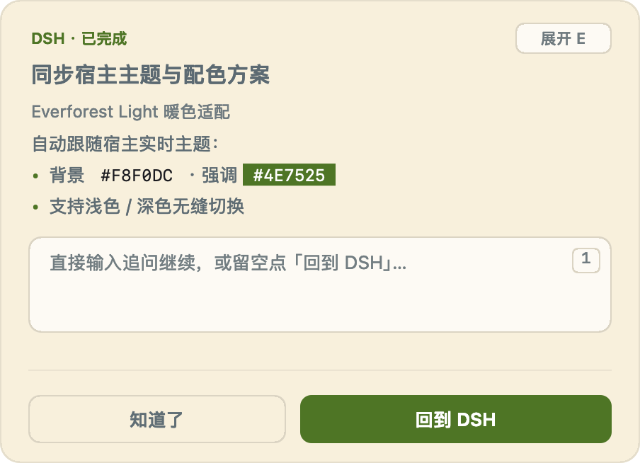
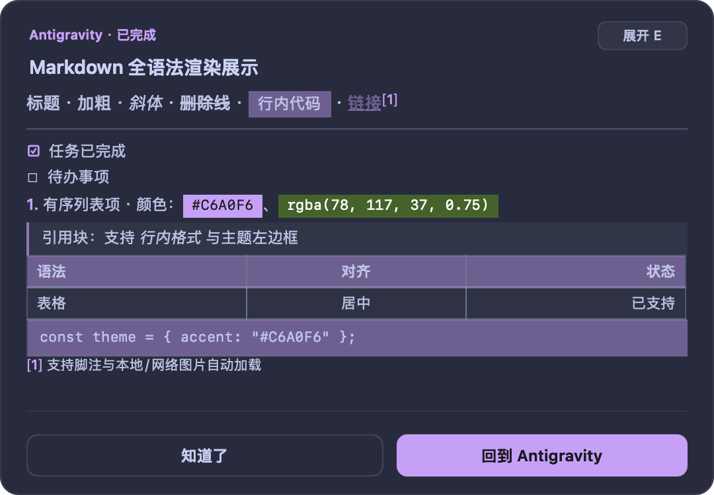

# answer-card

[](LICENSE)
[](#requirements)
[](#architecture)

**A host-agnostic macOS floating answer card: when an agent in Antigravity, DeepSeek Harness (DSH) or Zed needs your approval, an answer, or a wrap-up, the decision moves into an always-on-top window — one keystroke or one click, no window switching.**

Approve tool calls, answer single/multi-select or free-text questions, and jump back or send a follow-up without breaking focus.

```text
┌───────────────────────────────────────────────────┐
│ Antigravity · Needs your answer            [ Expand E ] │
│ answer-card · Confirm plugin architecture         │
│                                                   │
│ ┌───────────────────────────────────────────────┐ │
│ │ 1  Answer for me     Clicking equals answering │ │
│ ├───────────────────────────────────────────────┤ │
│ │ 2  Just switch back  Hand over to host's native UI │ │
│ └───────────────────────────────────────────────┘ │
│ ┌─────────────────────────────────────────────┬─┐ │
│ │ Optional note (Return = newline, ⌘⏎ = submit)… │3│ │
│ └─────────────────────────────────────────────┴─┘ │
│ [ Later ]                            [ Submit answer ] │
└───────────────────────────────────────────────────┘
```

## Screenshots

| Single / Multi-Select & Input | Completion & Follow-up (Antigravity) |
| :---: | :---: |
|  |  |

| Multi-Host Return (Zed) | Live Theme Adaptation (Warm Light) |
| :---: | :---: |
|  |  |

| Full Markdown & Color Swatch Rendering |
| :---: |
|  |

## Core Features

- **Approval on the card**: when a tool asks for permission the card pops up in the background with *Allow once / Allow for session / Always allow / Deny*, plus a free-text denial reason or replacement instruction. Antigravity automatically receives `permissionOverrides` so the native dialog does not appear twice; picking *Later* hands control back to the host UI with no loss.
- **Questions and multi-question forms**: single choice, multi choice, free text, and option + note combinations. Focusing the input clears a single-choice selection; partially answered multi-question forms can still be submitted.
- **Completion notice and inline follow-up**: a card pops up when a turn ends. Confirming with a blank input activates the host and raises the matching window by title keyword (multi-window aware); Antigravity and DSH also accept a follow-up typed straight into the completion card (Antigravity via `decision: continue`, DSH via `agent.followup()`), so the next turn runs without switching back.
- **Live theme adaptation**: follows the current agent's light/dark palette in real time — Antigravity through the MCP App `hostContext`, DSH through live style sync, Zed by reading `settings.json` and installed extension themes (Blur transparency included).
- **One visual settings panel across hosts**: a single `<answer-card-settings>` Web Component shared by all three hosts (Antigravity sidebar/full-page MCP App, DSH plugin settings section, Zed local settings page). All settings live in `~/.config/answer-card/settings.json` (shared layer plus per-host overrides).
- **Full keyboard control and Markdown rendering**: number keys select/clear/focus, `⌘`-combinations apply while typing, an always-present `Expand E` / `Collapse E` that never overflows the screen, and Markdown bodies (inline code, clickable links) that can be selected and copied with `⌘C`.
- **Non-intrusive and fail-open**: silently falls back to the native UI when the host is frontmost; supports per-workspace (exact path, or a trailing `/` prefix) and per-session muting plus a completion cooldown; any compile/exec error or timeout fails open and never blocks the agent.

## Keyboard Shortcuts

Outside the input box, a bare key is enough; while the cursor is inside the input box, prefix the same action with `⌘`:

| Action | Outside input | Inside input |
| --- | --- | --- |
| Select/clear an option, or focus the input | `1`–`9` (keypad included) | `⌘1`–`⌘9` |
| Expand / collapse the card (never overflows) | `E` | `⌘E` (keeps text and focus) |
| Submit / send follow-up | `Return` | `⌘Return` (`Return` inserts a newline) |
| Leave the input / dismiss (later) | `Esc` (closes the card) | `Esc` (leaves input focus first) |
| Copy / paste / cut / select all / undo | `⌘C` (copy selected body text) | `⌘C` / `⌘V` / `⌘X` / `⌘A` / `⌘Z` |

## Architecture

```text
answer-card/
├── plugin.json / hooks.json / mcp_config.json    # Antigravity native entry (installable from repo root)
├── rules/ / skills/ / assets/                    # Antigravity rules and the settings skill
├── package.json / cordis.patch.yml               # DeepSeek Harness (DSH) bundle entry
├── core/                                         # Shared core (zero runtime third-party deps, used by every host)
│   ├── swift/PromptWindow.swift                  # macOS AppKit floating window, --probe, --activate
│   ├── helper.mjs                                # swiftc build cache, foreground probe, cross-process mutex
│   ├── settings.mjs                              # unified config (global + hosts.<id> override), mute, cooldown
│   ├── theme.mjs                                 # cross-host theme resolution (snapshot / Zed extension / system appearance)
│   ├── protocol.mjs                              # approval / question / completion / test card payloads
│   ├── bridge.mjs                                # remote SSH reverse-forward bridge (auto server + client)
│   ├── settings-server.mjs                       # local 127.0.0.1 visual settings page (Zed / CLI reuse)
│   ├── mcp.mjs                                   # generic stdio MCP server (Zed / cross-host reuse)
│   └── cli.mjs                                   # generic settings, mute, test and local settings CLI
└── adapters/
    ├── shared/ui/                                # shared <answer-card-settings> Web Component
    ├── antigravity/                              # Antigravity PreToolUse / Stop hooks + MCP App
    ├── dsh/                                      # DeepSeek Harness Cordis plugin + web settings mount
    └── zed/                                      # Zed MCP launcher + optional ACP permission proxy
```

## Requirements

- **macOS 13+** (native AppKit floating window)
- **Node.js ≥ 20** (zero third-party runtime dependencies; UI artifacts are prebuilt, so no `npm install` after installation)
- **Xcode Command Line Tools** (provides `swiftc`; run `xcode-select --install` if missing)

> On first trigger `core/swift/PromptWindow.swift` is compiled and cached to `~/Library/Caches/answer-card/PromptWindow-<hash>` (about 1–3 seconds); later runs reuse it in milliseconds.

## Installation and Configuration

### 1. Antigravity

#### Option A: clone into the Antigravity plugin directory (recommended; works for App / IDE / CLI)

```bash
git clone https://github.com/Asthestarsfalll/answer-card.git ~/.gemini/config/plugins/answer-card
```

Optional: precompile the Swift helper once:

```bash
node ~/.gemini/config/plugins/answer-card/core/cli.mjs compile
```

#### Option B: install through the `agy` CLI

```bash
git clone https://github.com/Asthestarsfalll/answer-card.git
agy plugin install ./answer-card
```

Once enabled, open the built-in visual panel from **left sidebar → Answer Card**, **right side pane `+` → Answer Card**, or by asking "open Answer Card settings" in the conversation.

| Scenario | Hook / mechanism | Behavior |
| --- | --- | --- |
| Model asks a question (`ask_question`) | `PreToolUse` + `rules/AGENTS.md` | Question card pops up in the background; the answer is returned to the model directly, which continues; frontmost / later / timeout falls back to the native dialog |
| Tool approval (`run_command` / `call_mcp_tool` / `write_file` / `edit_file`) | `PreToolUse` | Approval card driven by `approvalPolicy`, with once/session/always allow and a denial-reason input |
| Turn completion | `Stop` | Completion card pops up; blank confirm switches back to the matching window, typed text returns `decision: "continue"` to run another turn |

> **Approval interception policy (`approvalPolicy`)**: `external` (default — intercepts out-of-sandbox/high-risk commands, writes outside the workspace, and MCP), `commands` (all commands and MCP), `mutating` (commands, file writes/edits and MCP), `all` (every matched tool).
>
> **On Antigravity's native permission gate and Turbo mode**: Antigravity's native permission gate runs *before* the `PreToolUse` hook. Switching **Settings → General → Global Permissions** to **Turbo** lets out-of-sandbox commands (`BypassSandbox: true`) through to `PreToolUse`, where Answer Card takes over. Sensitive paths outside the workspace (such as `~/.ssh/config`, `~/.gemini/config/config.json`) remain behind Antigravity's separate file boundary (you must enable **Non-Workspace File Access**, and some hard-coded sensitive directories always use the native confirmation). If you disable the `answer-card` plugin later, remember to restore the default preset.

---

### 2. DeepSeek Harness (DSH)

The repository keeps its DSH bundle entry intact (`package.json` + `cordis.patch.yml` + the shared settings component):

- **Desktop**: Settings → Plugins → Install, and enter `https://github.com/Asthestarsfalll/answer-card`
- **CLI**: `dsh plugin --profile desktop add file:/path/to/answer-card`

On first start the legacy `$DSH_HOME/dsh-answer-card.json` is migrated into `~/.config/answer-card/settings.json` under `hosts.dsh` (`skipWhenDSHFocused` is preserved), and the same `<answer-card-settings>` panel is mounted in the DSH settings page.

---

### 3. Zed

Zed gets a native MCP server from the shared `core/` (plus an optional ACP proxy); see [adapters/zed/README.md](adapters/zed/README.md).

Add this to `~/.config/zed/settings.json`:

```json
{
  "context_servers": {
    "answer-card": {
      "command": "/path/to/answer-card/adapters/zed/mcp.sh",
      "args": []
    }
  },
  "agent": {
    "tool_permissions": {
      "tools": {
        "mcp:answer-card:answer_card_ask": { "default": "allow" },
        "mcp:answer-card:answer_card_approve": { "default": "allow" },
        "mcp:answer-card:answer_card_notify": { "default": "allow" },
        "mcp:answer-card:answer_card_open_settings": { "default": "allow" },
        "mcp:answer-card:answer_card_settings": { "default": "allow" }
      }
    }
  }
}
```

The five MCP tools:
- `answer_card_ask`: show a floating question card and return the answer.
- `answer_card_approve`: show a floating approval card (denial reason / replacement instruction supported).
- `answer_card_notify`: show a completion card that switches back and raises the matching Zed window.
- `answer_card_open_settings`: start a local visual settings page bound to `127.0.0.1` (reuses `<answer-card-settings>`, applies Zed's current theme) and open it in the browser.
- `answer_card_settings`: read or change configuration, or send test cards, directly from a Zed conversation.

> To intercept native permission requests from an external ACP agent, wrap it with `adapters/zed/acp-proxy.sh -- <acp-agent>` in `agent_servers` (see [adapters/zed/README.md](adapters/zed/README.md)).

---

### 4. Remote SSH sessions (Linux server → card on your Mac)

With the Antigravity / Zed plugin enabled, macOS listens on `127.0.0.1:19876` (random bearer token; always uses the local Mac appearance/theme and `returnCommand`, and never executes commands passed from the remote side). Two steps make a remote SSH host use the local card:

1. **Add a reverse forward for the host in `~/.ssh/config`**:

```sshconfig
Host your-remote-host
  RemoteForward 19876 127.0.0.1:19876
```

2. **Deploy the plugin to the remote and sync the token from your Mac**:

```bash
node ~/.gemini/config/plugins/answer-card/core/cli.mjs ssh-install your-remote-host
```

Reconnecting over SSH is enough: the remote `PreToolUse` / `Stop` hooks detect `~/.config/answer-card/bridge-token` and forward approvals, questions and completion cards through the tunnel to your Mac (with no tunnel they fail open in milliseconds and fall back to the native UI).

## Shared Configuration and CLI

Every host shares `~/.config/answer-card/settings.json` (shared global appearance plus per-host overrides under `hosts.<id>`):

```bash
# Open the local visual settings page (focused on the given host)
node core/cli.mjs ui --host zed

# Show the effective configuration
node core/cli.mjs status --host antigravity

# Send a test card / test "return to host"
node core/cli.mjs test --host zed
node core/cli.mjs test-return --host zed

# Change a global (--global) or per-host (--host) setting
node core/cli.mjs set position cursor --global
node core/cli.mjs set width 500 --global
node core/cli.mjs set fontScale 1.1 --global
node core/cli.mjs set approvalPolicy commands --host antigravity

# Mute a workspace (a trailing / matches the whole subtree) or a session
node core/cli.mjs mute-workspace /path/to/workspace/ --host antigravity
node core/cli.mjs mute-session <sessionId> --host antigravity

# Enable the diagnostic trace log
node core/cli.mjs set traceFile /tmp/answer-card.log --global
```

## Development and Testing

```bash
npm run build:ui   # rebuild frontend artifacts after changing adapters/shared/ui or a host settings entry (needs npm install first)
npm run check      # full JS syntax check
npm test           # unit tests for the core and all three host adapters
npm run compile    # precompile the macOS Swift helper
```

## License

[MIT](LICENSE) © 2026 Asthestarsfalll
